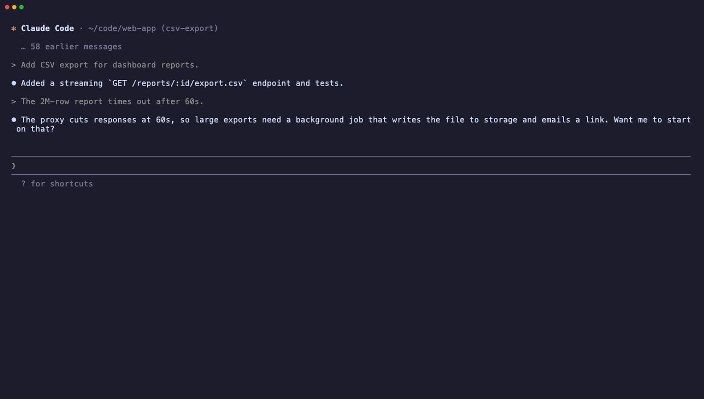

# claude-park

You run a dozen terminal tabs, each with Claude Code in its own git worktree.
A task is half done when something more urgent comes up, and you want to come
back to it in a few weeks. Until then:

- Idle tabs use memory and hide the sessions you are actually working in.
- Getting a session back means finding its id and `cd`-ing to its worktree by
  hand.
- Asking a stale session "where were we?" re-sends its whole context
  uncached. That is one full-price request over hundreds of thousands of
  tokens.
- A cleanup script, or another agent looking for disk space, sees an
  "abandoned" worktree and deletes it.
- By default, Claude Code deletes transcripts after 30 days without
  activity.

claude-park fixes this with two commands:

```
!park     # inside Claude Code: shelve this session and close its tab
parked    # in any shell: pick a parked session and resume it
```



## How parking works

`!park` is a shell command, not a slash command, so the parked session's
model never runs and its context is never re-sent. A background job gives a
trimmed transcript excerpt (opening request, latest compaction summary, most
recent turns, about 60K characters) to Haiku, which writes the park card:
goal, what is done, next steps, and gotchas.

Parking also:

1. Records the title, directory, branch, ahead/dirty counts, last commit, PR
   (via `gh`), and last prompt in `~/.claude/parked/<session-id>.json`.
2. Locks linked worktrees with `git worktree lock`, with a reason that starts
   with `claude-park:`. `git worktree remove` and `prune` refuse locked
   worktrees, and `git worktree list` shows them as locked. A worktree that
   is already locked is left as it is.
3. Writes `PARKED.md` at the worktree root: a "parked, not abandoned"
   notice, the resume command, and the card, for agents and scripts that
   ignore git locks. It is hidden from `git status` through
   `.git/info/exclude`. A `PARKED.md` that claude-park did not write is never
   overwritten or deleted.
4. Deletes gitignored, rebuildable directories (`target`, `node_modules`,
   `.venv`, `.next`, …) and records what was freed. Only paths git reports as
   ignored are touched. `--no-clean` keeps them.
5. Hard-links the transcript into `~/.claude/parked/transcripts/`, so Claude
   Code's `cleanupPeriodDays` cleanup can't delete it. This costs no extra
   disk. Resume links it back if the original is gone.
6. Stops the Claude process and closes the iTerm2 pane.

If the session is still warm, the optional `/park` skill has the session
write its own card instead, which costs nothing extra while the prompt cache
is live.

## Resuming

`parked` opens an fzf picker with one line per session: age, repo, title,
phase, and git state.

```
  3d  api-server       Rate limiter for the public search API        ▰▰▰▰▱ review    PR #482 open
  9d  web-app          Migrate settings page to new form library     ▰▰▱▱▱ design    2 uncommitted
```

A second, small Haiku pass over the card produces the title, phase
(research → design → build → review → wrap-up), a one-line status, and the
top three next steps. The preview shows that short view.

| key    | action |
| ------ | ------ |
| enter  | resume here (`cd <worktree> && claude --resume <id>`) |
| ctrl-t | resume in a new iTerm2 tab |
| ctrl-f | fresh session in the worktree, seeded with the card instead of the full history |
| ctrl-x | drop: unpark without resuming |
| ctrl-o | switch the preview between the short view and the full card |

Resuming or dropping unlocks the worktree, removes `PARKED.md`, and archives
the card. The first turn after `--resume` re-sends the full history; use
ctrl-f to skip that when the card is enough.

Parking the same session again starts from the archived card. With no new
turns, the card is reused without a model call. With new turns, Haiku updates
the card from only those turns, so context that has scrolled out of the
excerpt window survives repeated park/resume cycles. If the update fails, the
old card stays, marked stale, and the next park retries.

Every action also works without the picker:

```
parked list
parked show [--brief] [--color] <id-prefix|title>
parked resume [--tab] [--fresh] <id-prefix|title>
parked drop <id-prefix|title>
parked refresh [--all] [<id>]          # regenerate titles and short views from cards
parked summarize <id-prefix|title>     # regenerate the card
parked doctor [--session <id>]         # check transcripts are still readable
park --no-clean | --no-close | --no-summary | --no-pr
```

## Install

```
./install.sh            # links claude-park, park, parked into ~/.local/bin
```

Requires macOS, Python 3.9+, and git. iTerm2 is needed to close and open
tabs; elsewhere parking still works but the tab stays open. fzf (for the
picker) and gh (for PR links) are optional.

To install the optional `/park` skill:

```
claude plugin marketplace add hotdata-dev/claude-park
claude plugin install park@claude-park
```

Settings, via environment variables:

- `CLAUDE_PARK_MODEL`: summary model (default `haiku`)
- `CLAUDE_PARK_DIR`: where cards live (default `~/.claude/parked`)

## Claude Code compatibility

claude-park reads Claude Code's transcripts
(`~/.claude/projects/*/<session-id>.jsonl`) and the `CLAUDE_CODE_SESSION_ID`
environment variable. Neither is a documented, stable interface, so a format
change fails loudly instead of producing empty cards:

- If a transcript has entries but no readable turns, parking skips the
  summary, marks the card "transcript format not recognized (Claude Code
  <version>)", and prints a warning.
- Each card records the Claude Code version that wrote the transcript.
- `parked doctor` parses your latest transcript (or `--session <id>`) and
  reports which fields it found. Run it after upgrading Claude Code; it exits
  non-zero when the format is not recognized.

## Tests

```
python3 -m unittest discover -s tests
```

The demo above uses fictional data in `/tmp/claude-park-demo`, with
stand-ins for `claude` and `gh`. Rebuild it with `docs/demo/render.sh`
(needs [VHS](https://github.com/charmbracelet/vhs) and fzf).

## License

MIT. See [LICENSE](LICENSE).
